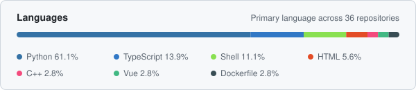

# languages-card

A languages card for your GitHub profile that also counts your private repositories.



Most stats cards only see public repos, so if most of your work is private they end up showing something like "Python 100%". This one runs in your own repo with your own token, so it sees everything. It follows the reader's light/dark theme and refreshes itself once a week.

One Python file, no dependencies.

## Setup

**1. Create a token.** Go to [Settings → Fine-grained tokens](https://github.com/settings/personal-access-tokens/new):

- Repository access: **All repositories**
- Repository permissions: add **Commit statuses → Read-only**

The second point looks odd but matters: GitHub won't save "All repositories" unless at least one permission is selected, and quietly switches back to public only. Commit statuses is harmless and doesn't give access to your code.

**2. Save it as a secret** in your profile repo (`you/you`): Settings → Secrets and variables → Actions → New repository secret, name it `LANGS_TOKEN`.

**3. Add the workflow** as `.github/workflows/languages.yml`:

```yaml
name: Languages card

on:
  schedule:
    - cron: "0 6 * * 1" # every Monday
  workflow_dispatch:

permissions:
  contents: write

jobs:
  card:
    runs-on: ubuntu-latest
    steps:
      - uses: actions/checkout@v4
      - uses: ivanvilarinom/languages-card@main
        with:
          token: ${{ secrets.LANGS_TOKEN }}
```

**4. Run it once** from the Actions tab (Languages card → Run workflow), then add the card to your README:

```html

```

If the run log shows a warning about public repositories, the token is missing access to private ones. Check step 1.

## Options

| Input    | Default         | Description                               |
|----------|-----------------|-------------------------------------------|
| `token`  | required        | The token from step 1.                    |
| `path`   | `languages.svg` | Where to write the card.                  |
| `commit` | `true`          | Commit and push the card when it changes. |

## How it counts

Each repository counts once, by the primary language GitHub detects for it. Forks and repos without a detected language are skipped. The top seven are shown and the rest are grouped as "Other".

So it tells you what you build things with, not how many lines you wrote in each language. A small Shell repo weighs the same as a big Python one. That was a deliberate choice: byte counts get skewed by vendored code, notebooks and generated files.

## Running it locally

```sh
GH_TOKEN=github_pat_... python3 languages.py card.svg
python3 languages.py --demo   # quick self-check, no token needed
```

## License

MIT
